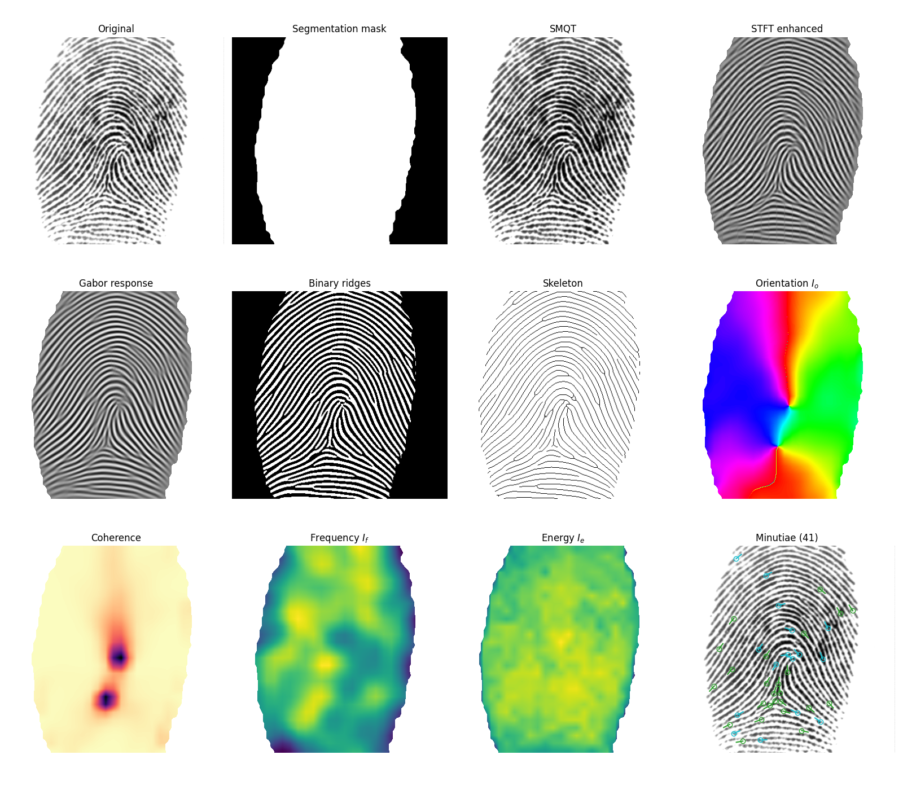
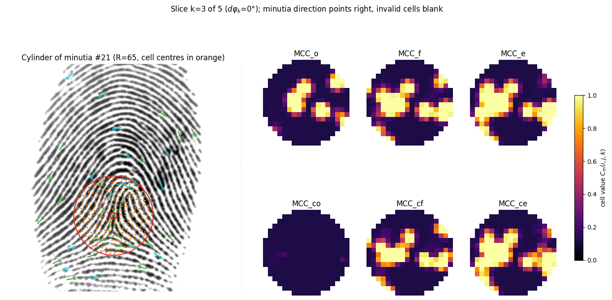
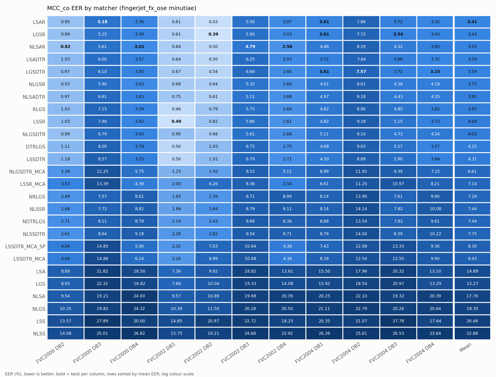
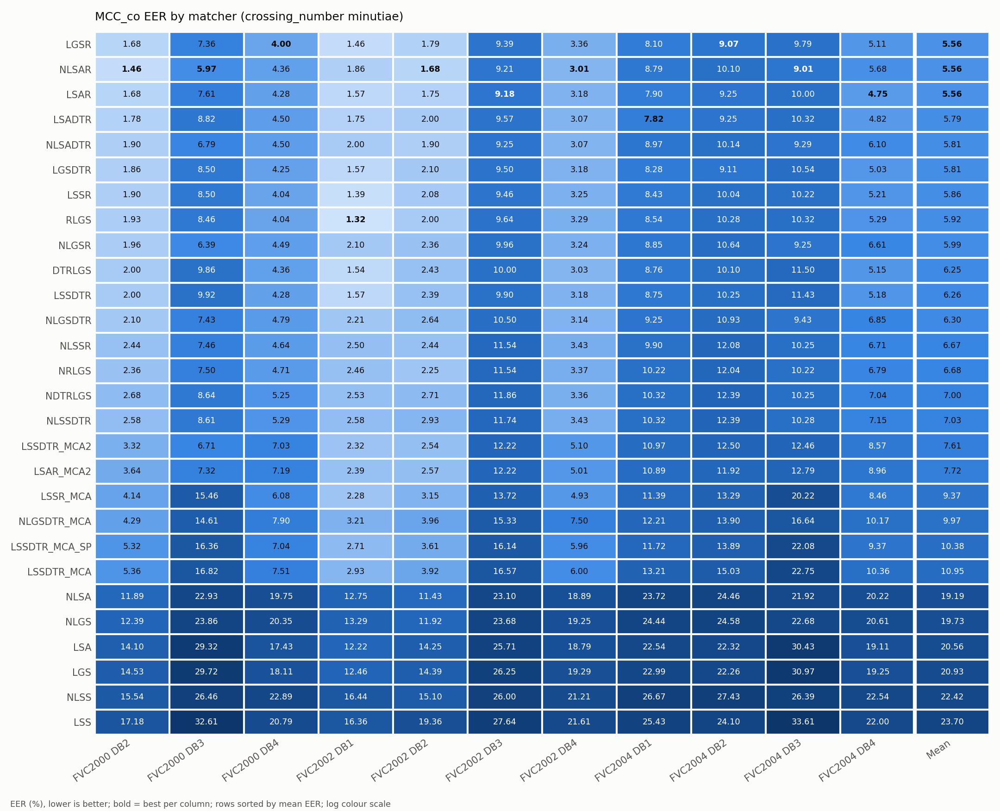
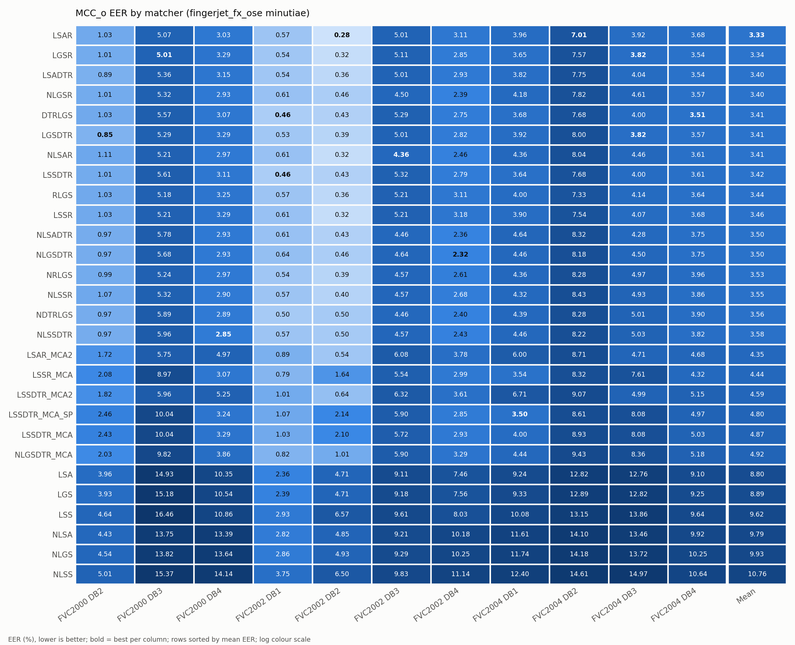
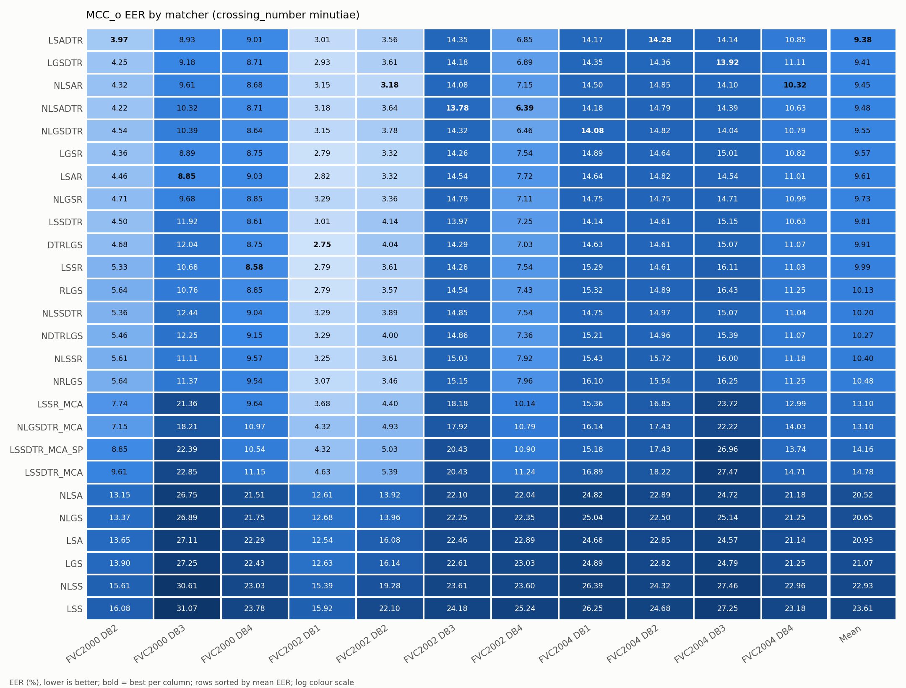
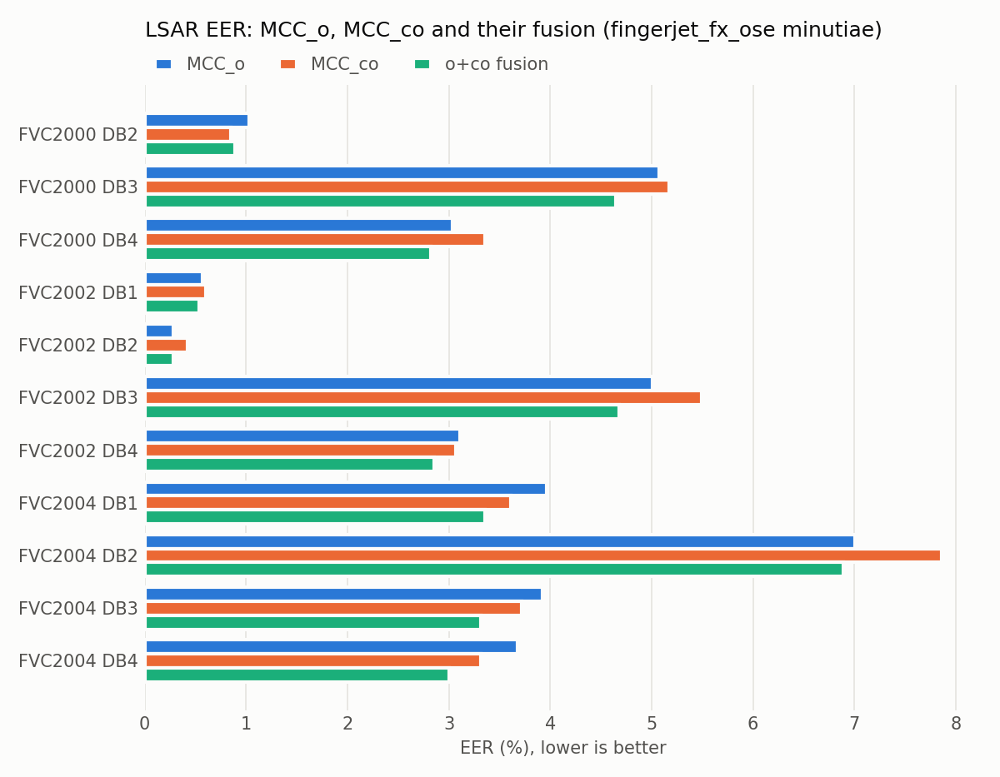
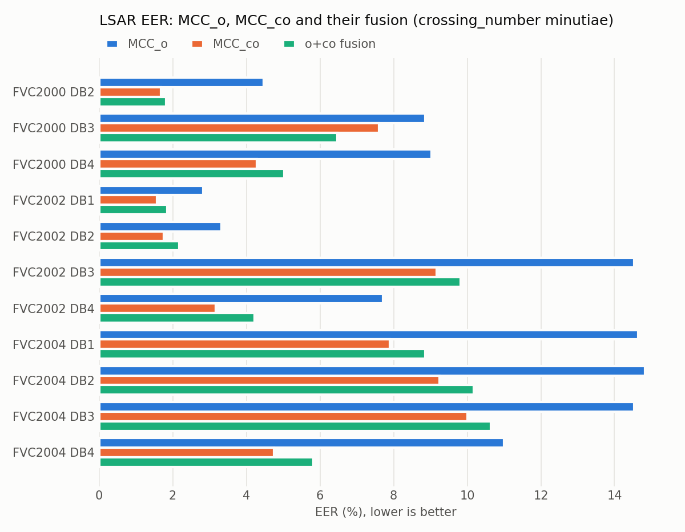
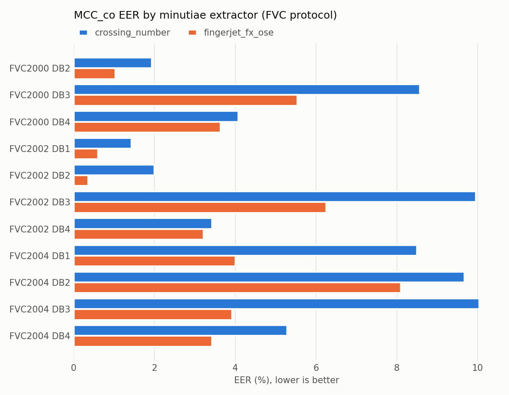

# MTCC Python Implementation

**Minutia Texture Cylinder Codes for fingerprint matching**: a clean Python implementation of
Baig et al., 2018 ([arXiv:1807.02251](https://arxiv.org/abs/1807.02251)).

MTCC extends Minutia Cylinder-Code (MCC, Cappelli et al. 2010). It replaces the minutia-angle
directional contribution of each cylinder cell with local texture: orientation, frequency and
energy from STFT analysis.

> **Implemented by Claude Opus 5.5** (Anthropic, via Claude Code, October 2026), working from the
> paper under the guidance of its author. Claude Opus 5.5 wrote the `mtcc/` package, ran every FVC
> benchmark below and produced the figures. Earlier attempts by other LLMs are in [`archive/`](archive/).

## Install

```bash
pip install -r requirements.txt
```

## Usage

```bash
# Extract a template; optionally save the pipeline and cylinder figures
python -m mtcc extract 1_1.tif -o 1_1.npz --variant co --plot pipeline.png --plot-cylinder cylinder.png

# Match two images or templates (default matcher LSAR; any matcher name, e.g. --matcher NLSADTR)
python -m mtcc match 1_1.npz 1_2.tif --variant co

# FVC protocol (2800 genuine / 4950 impostor) on one database, all variants
python -m mtcc evaluate FVC2002/Db1_a --jobs 8 --out results/crossing_number/FVC2002_db1_a.json

# Same, with the FingerJet FX OSE minutiae extractor (pass the scan resolution, e.g. 569 for FVC2002 DB2)
python -m mtcc evaluate FVC2002/Db2_a --extractor fingerjet_fx_ose --dpi 569 --jobs 8

# Several matchers at once (they share each similarity matrix); --scores keeps per-pair scores
python -m mtcc evaluate FVC2002/Db1_a --variants o co --matchers LSAR LGSR NLSAR LSSDTR --out run/FVC2002_db1_a.json

# Matcher x database table (Markdown) and EER heatmap for a folder of evaluate results
python -m mtcc matchers results/fingerjet_fx_ose --variant co --plot docs/matchers_fingerjet_fx_ose_co.png
```

From Python:

```python
from mtcc import Params, read_image, templates, match

p = Params()                       # or Params(extractor='fingerjet_fx_ose', dpi=500)
a = templates(read_image('1_1.tif'), ['co'], p)['co']
b = templates(read_image('1_2.tif'), ['co'], p)['co']
print(match(a, b, p))
```

## Pipeline

All stages on FVC2002 DB1_A `1_1.tif`:



| Step | Module | Notes |
|------|--------|-------|
| Segmentation | `enhance.segment` | Block-wise variance, morphological open/close, largest component |
| SMQT | `enhance.smqt` | Successive Mean Quantization Transform, 8 levels, applied before STFT |
| STFT analysis + enhancement | `enhance.stft` | 14 px blocks, 6 px overlap; spectral moments give I_o, I_f, I_e and coherence; contextual angular × radial filtering (Chikkerur et al.) |
| Gabor | `enhance.gabor` | Orientation-adaptive even Gabor at the median ridge frequency; its sign gives the ridge map |
| Minutiae | `extractors.py` | Pluggable: `crossing_number` (`minutiae.py`) or `fingerjet_fx_ose` (`fingerjet/`), see below |
| Singular points | `singular.py` | Cores and deltas by the Poincaré index of the smoothed orientation field (`_SP` matchers) |
| Cylinders | `cylinder.py` | Eqs. 1–14, variants `o f e co cf ce` |
| Template | `pipeline.make_template` | Valid cylinders, minutiae, nearest-neighbour table and neighbourhood quality (`mca.py`) |
| Matching | `match.py` | Euclidean (Eq. 15) for `o`, double-angle (Eqs. 16–18) for texture; 26 global-score matchers, default LSAR (see [Matchers](#matchers)) |
| Evaluation | `evaluate.py` | FVC protocol, EER, FMR1000 |

### Minutiae extractors

`Params.extractor` (CLI `--extractor`) selects the minutiae extractor. Enhancement, texture maps,
cylinders and matching are the same for both. Both return the same `(N, 5)` array: x, y (pixels), θ (radians,
image axes), type (1 ending, 3 bifurcation, 0 other) and quality. A new extractor is a function with the
`MinutiaeExtractor` signature added to `extractors.EXTRACTORS`.

| Name | Code | Method |
|------|------|--------|
| `crossing_number` (default) | `minutiae.py` | Thinning of the Gabor ridge map, crossing number, ridge tracing for direction, border/cluster/spur removal |
| `fingerjet_fx_ose` | `fingerjet/` | Pure-Python port of [FingerJet FX OSE](https://github.com/wajihullahbaig/FingerJetFXOSE_VS), the extractor used in the paper |

The FingerJet port follows the C++ library in
[wajihullahbaig/FingerJetFXOSE_VS](https://github.com/wajihullahbaig/FingerJetFXOSE_VS) (a Visual Studio
build of [FingerJetFXOSE/FingerJetFXOSE](https://github.com/FingerJetFXOSE/FingerJetFXOSE)), one module
per C++ header in `libFRFXLL/src/algorithm`:

| Module | C++ source | Stage |
|--------|------------|-------|
| `orimap.py` | `imresize.h`, `orimap.h` | Resample to 333 dpi, 4×4 block orientation map and footprint |
| `fft_enhance.py` | `block_fft.h`, `fft_enhance.h` | Integer-FFT contextual enhancement in 32×32 blocks |
| `phasemap.py` | `freeman.h`, `conv2.h` | Steerable-filter ridge phase map |
| `detect.py` | `extract_minutia.h`, `top_n.h` | Phase-gradient tensor candidates, angle tracing, top-68 by confidence |
| `biffilt.py` | `biffilt.h` | Rotated bifurcation filter bank: confirmation, type, confidence |
| `intmath.py` | `intmath.h`, `complex.h`, `delay.h` | Fixed-point sin/cos/atan2 tables and helpers |

The C++ streaming delay-line filters are rewritten as numpy operations, but the integer arithmetic is kept, so the
output is bit-exact. It was checked against the compiled C++ library on 176 runs
(8 images from each of 11 FVC databases, with and without enhancement): every intermediate map and every
minutia matches exactly. Extraction takes about 0.3 s per image.

Differences from the C++ library, all switchable in `Params`:
- No cropping to 256×400 px at 333 dpi (`fj_crop=False`); large FVC2004 images keep their borders.
- Minutiae are returned in input-image pixels, not as an ISO/ANSI template. The library's
  phasemap offset (1, 6) is kept.
- FingerJet directions point into the ridge(s) for both minutia types. The `crossing_number` extractor points out of the
  ridge at endings. Matching only compares angles from the same extractor, so this has no effect.

The `fingerjet/` package is a derivative of FingerJet FX OSE (© 2011 DigitalPersona, Inc.) and stays under
the GNU LGPL v3 or later.

### MTCC cylinder

The cylinder of one minutia from the same image (left), and slice k = 3 of 5 (dφ_k = 0°) of
that cylinder for each variant (right). In each slice the minutia direction points to the right,
and invalid cells are blank.



All parameters live in `mtcc/config.py`. The cylinder and matching values are those of Table IV of the paper.

### Implementation choices where the paper is not explicit

- **Pipeline order**: SMQT → STFT → Gabor.
- **STFT window**: the 14×14 block plus 6 px overlap on each side (26 px window, 32-point FFT), following Chikkerur's STFT code.
- **I_f, I_e → [−π, π]**: per-image min-max over the foreground (1st–99th percentile).
- **G_F, G_E**: the same integrated Gaussian as G_D (σ_D).
- **Relaxation**: compatibility ρ and iteration from the MCC paper, with Table IV parameters; at most 40 pairs enter it.
- **Minutiae**: the default `crossing_number` extractor is a simple pure-Python one, so absolute EERs differ from the paper.
  The paper's FingerJet FX OSE extractor is available as `--extractor fingerjet_fx_ose`.

## Matchers

The global score is built from consolidation stages of Cappelli et al. (MCC, PAMI 2010, Sec. 5) and of the
author's MATLAB matchers. A matcher name chains them in order, so every MATLAB name runs as is:
`NLSADTR` = N → LSA → DTR, `RLGS` = LSS → R → LGS, `LSSDTR_MCA_SP` = LSS → DTR with MCA and SP.

| Stage | What it does |
|-------|--------------|
| `N` | Normalise each local similarity by `1 − (sum of the other cells in its row and column) / (nA + nB − 2)` |
| `LSS` | Candidate pairs: every cell, by decreasing similarity (not one-to-one) |
| `LSA` | Candidate pairs: optimal one-to-one assignment (Hungarian, `scipy.optimize.linear_sum_assignment`) |
| `LGS` | Greedy one-to-one: drop pairs whose minutiae an earlier pair already used (before or after relaxation) |
| `R` | Relaxation by geometric compatibility (distance, direction and radial-angle differences); keeps the n_P most efficient pairs |
| `DTR` | Distortion-tolerant relaxation: the distance term uses `|d_A − d_B| / (d_A + d_B)` (μ = 1/30, τ = −150) |
| `_MCA` | Minutiae coherence analysis: neighbourhood coherence and quality set the relaxation start values and final weights |
| `_SP` | MCA qualities weighted by position relative to a singular point (core, else delta, else minutiae centroid) |
| `_MCA2` | Revised MCA: relaxation starts from the local similarity × rotation-invariant neighbourhood agreement (see [fusion run](#mcc_o--mcc_co-score-fusion)) |

Without `R`/`DTR`, the score is the mean of the n_P best candidates; with them, the mean of the n_P most
efficient relaxed values. `python -m mtcc evaluate --matchers ...` evaluates any of them; the 26 distinct pipelines benchmarked below are listed in
`match.MATCHERS`. When both `o` and `co` are evaluated, the results also hold their mean-rule score fusion `o+co`.

### Differences from the MATLAB code

- **R** uses Cappelli's distance term (μ = 12, τ = −0.8). The MATLAB used the DTR values (1/30, −150) on pixel
  distances, which makes almost every pair of pairs incompatible.
- **LSS** takes the top cells of the whole matrix (Cappelli). The MATLAB used the best cell of each column.
- **Names are followed where the MATLAB body differs:** `DTRLGS` called plain R (it equalled `RLGS`), and `NLGSR` /
  `NLGSDTR` ran LGS after relaxation.
- **Duplicates are not listed separately:** LGS after LSA changes nothing (the assignment is already one-to-one), so
  `LSARLGS` = `LSAR`, `NLSARLGS` = `NLSALGSR` = `NLSAR`, and `NLSADTRLGS` = `NLSALGSDTR` = `NLSADTR`.
- **MCA**: the quantified variant of `LSSDTR_MCA.m` is used by all three `_MCA` matchers (`LSSR_MCA.m` and
  `NLGSDTR_MCA.m` used slightly different start values). Neighbours are the 20 nearest typed minutiae within R + 3σ_S.
- **SP**: the MATLAB core/delta-first passes ended up building the full similarity matrix, and its quality
  penalty was only stored when no singular point was found. The port applies the intended penalty (×0.75 / ×0.5 for
  minutiae beyond R + 3σ_S in the 135–180° / 180–285° sectors) around the first core, else delta, else centroid, and
  only in `_SP` matchers. The MATLAB detector (`walking.m`) is replaced by the Poincaré index.

## Results

FVC protocol on every `_A` database: 2800 genuine and 4950 impostor comparisons each, default `Params`,
no per-database tuning. Scan resolution as given per database (`--dpi 569` for FVC2002 DB2, `--dpi 512` for FVC2004
DB3, 500 otherwise). Every run evaluates all 26 matchers on all six variants; the raw numbers are in
[`results/crossing_number/`](results/crossing_number/) and [`results/fingerjet_fx_ose/`](results/fingerjet_fx_ose/).

### Matcher comparison

Mean EER (%) over the 11 databases for a selection of matchers (all 26 are in the heatmaps below). Best per column in bold.

| Matcher | Stages | FingerJet MCC_o | FingerJet MCC_co | crossing_number MCC_o | crossing_number MCC_co |
|---|---|--:|--:|--:|--:|
| LSAR | LSA → R | **3.33** | **3.41** | 9.61 | **5.56** |
| LGSR | LSS → LGS → R | 3.34 | 3.43 | 9.57 | **5.56** |
| NLSAR | N → LSA → R | 3.41 | 3.53 | 9.45 | **5.56** |
| LSADTR | LSA → DTR | 3.40 | 3.59 | **9.38** | 5.79 |
| LSSR | LSS → R | 3.80 | 4.04 | 9.99 | 6.55 |
| LSSDTR | LSS → DTR | 3.69 | 4.31 | 9.81 | 7.27 |
| NLSSR | N → LSS → R | 4.15 | 7.44 | 10.40 | 8.35 |
| LSSDTR_MCA | LSS → DTR → MCA | 5.44 | 8.43 | 14.78 | 13.15 |
| LSSDTR_MCA_SP | LSS → DTR → MCA → SP | 5.37 | 8.30 | 14.16 | 12.79 |
| LSA | LSA | 8.80 | 14.89 | 20.93 | 20.56 |
| LSS | LSS | 10.69 | 20.46 | 23.61 | 26.21 |

#### EER heatmaps, MCC_co





<details>
<summary>EER heatmaps, MCC_o</summary>





</details>

Reproduce with `python -m mtcc matchers results/fingerjet_fx_ose --variant co --plot docs/matchers_fingerjet_fx_ose_co.png`
(it also prints the full Markdown table).

**What the matcher comparison shows**

- **Relaxation does most of the work.** Without R or DTR (LSS, LSA, LGS and their N versions) the mean EER is
  2–6× higher, and on single databases up to 25×.
- **One-to-one pairs before relaxation help.** LSA → R (LSAR) and greedy LGS → R (LGSR) are at or near the top in all
  four settings and lower the mean EER of Cappelli's LSS → R (LSSR) by 4–16%. LSSR is still best on FVC2002 DB1
  (0.40% with MCC_co).
- **R vs DTR is close.** R is slightly better with FingerJet minutiae; DTR wins with the noisier crossing-number
  minutiae on MCC_o (LSADTR 9.38%).
- **Normalisation (N) needs a one-to-one selector.** NLSAR ties for best on crossing-number MCC_co and is best on
  FVC2002 DB3/DB4 with FingerJet, but N before LSS nearly doubles the MCC_co error (NLSSR 7.44% vs LSSR 4.04%).
- **MCA as in the MATLAB code is worse everywhere** (LSSDTR_MCA 8.43% vs LSSDTR 4.31%, FingerJet MCC_co), and the
  singular-point weights change it little. Its start values `w(v + me)/2` are nearly the same for every pair, so the
  cylinder similarity no longer enters the relaxation, and dense templates collect high impostor scores.
- **LSAR is the default** (`Params.matcher`): best mean EER with FingerJet on both MCC_o and MCC_co and tied best
  on crossing-number MCC_co. Against the previous default (greedy one-to-one + R, no 40-pair cap) the mean MCC_co EER
  drops from 3.64% to 3.41% (FingerJet) and from 5.90% to 5.56% (crossing number).

### MCC_o + MCC_co score fusion

`python -m mtcc evaluate DB --variants o co` also reports `o+co`, the mean of the two scores of each comparison.
This run used eight matchers, including the revised `_MCA2`; the numbers are in [`results/fusion/`](results/fusion/).
Best per row in bold.



#### fingerjet_fx_ose: mean EER (%) over 11 databases

| Matcher | MCC_o | MCC_co | o+co |
|---|--:|--:|--:|
| LSAR | 3.33 | 3.41 | **3.03** |
| LGSR | 3.34 | 3.43 | **3.03** |
| NLSAR | 3.41 | 3.53 | **3.17** |
| LSADTR | 3.40 | 3.59 | **3.17** |
| LSSR | 3.80 | 4.04 | **3.33** |
| LSSDTR | 3.69 | 4.31 | **3.47** |
| LSAR_MCA2 | 4.35 | 4.15 | **3.88** |
| LSSDTR_MCA2 | 4.95 | 4.32 | **4.09** |

#### fingerjet_fx_ose: LSAR per database, EER % (FMR1000 %)

| Database | MCC_o | MCC_co | o+co | Paper |
|---|--:|--:|--:|--:|
| FVC2000 DB2 | 1.03 (1.79) | **0.85** (1.68) | 0.89 (1.57) | – |
| FVC2000 DB3 | 5.07 (8.11) | 5.18 (8.00) | **4.64** (7.75) | – |
| FVC2000 DB4 | 3.03 (10.43) | 3.36 (8.07) | **2.82** (7.86) | – |
| FVC2002 DB1 | 0.57 (0.75) | 0.61 (0.86) | **0.54** (0.64) | 0.42 |
| FVC2002 DB2 | **0.28** (0.50) | 0.43 (0.54) | **0.28** (0.46) | 0.38 |
| FVC2002 DB3 | 5.01 (14.46) | 5.50 (15.11) | **4.68** (14.46) | 4.42 |
| FVC2002 DB4 | 3.11 (6.18) | 3.07 (5.61) | **2.85** (5.57) | 1.61 |
| FVC2004 DB1 | 3.96 (11.82) | 3.61 (9.86) | **3.36** (10.93) | 3.85 |
| FVC2004 DB2 | 7.01 (15.79) | 7.86 (15.07) | **6.89** (14.25) | 5.35 |
| FVC2004 DB3 | 3.92 (8.39) | 3.72 (7.61) | **3.32** (7.04) | 3.78 |
| FVC2004 DB4 | 3.68 (8.04) | 3.32 (8.93) | **3.01** (6.43) | 2.38 |

<details>
<summary>crossing_number minutiae</summary>



#### crossing_number: mean EER (%) over 11 databases

| Matcher | MCC_o | MCC_co | o+co |
|---|--:|--:|--:|
| LSAR | 9.61 | **5.56** | 6.08 |
| LGSR | 9.57 | **5.56** | 6.15 |
| NLSAR | 9.45 | **5.56** | 6.32 |
| LSADTR | 9.38 | **5.79** | 6.08 |
| LSSR | 9.99 | **6.55** | 6.87 |
| LSSDTR | 9.81 | 7.27 | **7.10** |
| LSAR_MCA2 | 10.54 | **7.72** | 8.23 |
| LSSDTR_MCA2 | 10.61 | **7.38** | 7.98 |

#### crossing_number: LSAR per database, EER % (FMR1000 %)

| Database | MCC_o | MCC_co | o+co |
|---|--:|--:|--:|
| FVC2000 DB2 | 4.46 (12.39) | **1.68** (3.75) | 1.82 (6.25) |
| FVC2000 DB3 | 8.85 (24.14) | 7.61 (13.61) | **6.46** (16.25) |
| FVC2000 DB4 | 9.03 (24.29) | **4.28** (9.61) | 5.03 (14.11) |
| FVC2002 DB1 | 2.82 (6.39) | **1.57** (3.39) | 1.86 (3.18) |
| FVC2002 DB2 | 3.32 (6.32) | **1.75** (2.96) | 2.18 (3.75) |
| FVC2002 DB3 | 14.54 (37.75) | **9.18** (29.68) | 9.82 (31.68) |
| FVC2002 DB4 | 7.72 (19.96) | **3.18** (8.32) | 4.22 (11.82) |
| FVC2004 DB1 | 14.64 (41.54) | **7.90** (25.61) | 8.85 (29.96) |
| FVC2004 DB2 | 14.82 (37.18) | **9.25** (24.43) | 10.18 (29.57) |
| FVC2004 DB3 | 14.54 (42.46) | **10.00** (25.50) | 10.64 (28.68) |
| FVC2004 DB4 | 11.01 (30.39) | **4.75** (16.54) | 5.82 (20.86) |

</details>

**What the fusion run shows**

- **With FingerJet, fusion helps every matcher.** LSAR drops from 3.33% (MCC_o) and 3.41% (MCC_co) to 3.03% mean
  EER, and the fused score is best or tied on 10 of 11 databases, with lower FMR1000 on most. With one fixed setting
  (LSAR, o+co) three paper databases are below the paper (FVC2002 DB2 0.28 vs 0.38, FVC2004 DB1 3.36 vs 3.85,
  FVC2004 DB3 3.32 vs 3.78).
- **With crossing-number minutiae, equal-weight fusion hurts.** MCC_o is much weaker there (9.61% vs 5.56% for
  LSAR), so averaging pulls MCC_co down on 10 of 11 databases; MCC_co alone stays the better choice.
- **The revised MCA does not beat plain relaxation.** `_MCA2` fixes the MATLAB MCA (LSSDTR_MCA 8.43% → LSSDTR_MCA2
  4.32%, FingerJet MCC_co) but never beats the same matcher without it: it ties LSSDTR on MCC_co (4.32% vs 4.31%)
  and is up to 2.2 points worse elsewhere. Relaxation
  already rewards pairs that agree geometrically with other matched pairs; agreement among unmatched neighbours
  adds noise from minutiae that differ between impressions. On FVC2002 DB1, comparing absolute instead of relative
  neighbour directions raises the EER from 0.85% to 6.61%, so rotation invariance was the main defect of the MATLAB
  version.

### Minutiae extractor comparison (EER %, MCC_co, LSAR)



| Database | crossing_number | fingerjet_fx_ose | Paper |
|----------|----------------:|-----------------:|------:|
| FVC2000 DB2 | 1.68 | **0.85** | – |
| FVC2000 DB3 | 7.61 | **5.18** | – |
| FVC2000 DB4 | 4.28 | **3.36** | – |
| FVC2002 DB1 | 1.57 | **0.61** | 0.42 |
| FVC2002 DB2 | 1.75 | **0.43** | 0.38 |
| FVC2002 DB3 | 9.18 | **5.50** | 4.42 |
| FVC2002 DB4 | 3.18 | **3.07** | 1.61 |
| FVC2004 DB1 | 7.90 | **3.61** | 3.85 |
| FVC2004 DB2 | 9.25 | **7.86** | 5.35 |
| FVC2004 DB3 | 10.00 | **3.72** | 3.78 |
| FVC2004 DB4 | 4.75 | **3.32** | 2.38 |

Reproduce with `python -m mtcc compare results/crossing_number results/fingerjet_fx_ose --variant co --matcher LSAR --plot docs/eer_comparison.png`.
The paper column is MCC_co from Baig et al. (2018), which used FingerJet FX OSE minutiae; it has no FVC2000 results.

### `fingerjet_fx_ose` extractor (LSAR)

#### EER (%)

| Database | MCC_o | MCC_f | MCC_e | MCC_co | MCC_cf | MCC_ce |
|----------|------:|------:|------:|------:|------:|------:|
| FVC2000 DB2 | 1.03 | 2.39 | 2.22 | **0.85** | 2.39 | 2.18 |
| FVC2000 DB3 | **5.07** | 7.50 | 8.25 | 5.18 | 7.25 | 7.92 |
| FVC2000 DB4 | **3.03** | 5.57 | 5.15 | 3.36 | 5.68 | 4.71 |
| FVC2002 DB1 | **0.57** | 1.01 | 1.25 | 0.61 | 1.03 | 1.25 |
| FVC2002 DB2 | **0.28** | 1.07 | 0.76 | 0.43 | 0.93 | 0.85 |
| FVC2002 DB3 | **5.01** | 9.15 | 8.54 | 5.50 | 8.50 | 7.90 |
| FVC2002 DB4 | 3.11 | 4.61 | 3.50 | **3.07** | 4.46 | 3.32 |
| FVC2004 DB1 | 3.96 | 8.72 | 9.07 | **3.61** | 8.79 | 8.75 |
| FVC2004 DB2 | **7.01** | 14.04 | 13.32 | 7.86 | 13.68 | 13.01 |
| FVC2004 DB3 | 3.92 | 5.75 | 6.96 | **3.72** | 5.43 | 6.43 |
| FVC2004 DB4 | 3.68 | 5.07 | 5.07 | **3.32** | 5.61 | 4.89 |

#### FMR1000 (% FNMR at FMR ≤ 0.1%)

| Database | MCC_o | MCC_f | MCC_e | MCC_co | MCC_cf | MCC_ce |
|----------|------:|------:|------:|------:|------:|------:|
| FVC2000 DB2 | 1.79 | 4.50 | 5.25 | **1.68** | 4.29 | 4.43 |
| FVC2000 DB3 | 8.11 | 11.00 | 11.68 | **8.00** | 10.64 | 11.36 |
| FVC2000 DB4 | 10.43 | 14.04 | 11.25 | **8.07** | 13.14 | 9.86 |
| FVC2002 DB1 | **0.75** | 1.61 | 2.54 | 0.86 | 1.61 | 1.82 |
| FVC2002 DB2 | **0.50** | 1.89 | 1.43 | 0.54 | 1.68 | 1.61 |
| FVC2002 DB3 | **14.46** | 21.36 | 19.64 | 15.11 | 19.54 | 19.25 |
| FVC2002 DB4 | 6.18 | 8.57 | 7.75 | **5.61** | 8.29 | 7.54 |
| FVC2004 DB1 | 11.82 | 22.11 | 25.25 | **9.86** | 20.64 | 24.46 |
| FVC2004 DB2 | 15.79 | 28.29 | 28.32 | **15.07** | 27.46 | 26.89 |
| FVC2004 DB3 | 8.39 | 9.93 | 11.46 | **7.61** | 10.39 | 10.79 |
| FVC2004 DB4 | **8.04** | 11.86 | 11.50 | 8.93 | 12.29 | 10.46 |

### `crossing_number` extractor (LSAR)

#### EER (%)

| Database | MCC_o | MCC_f | MCC_e | MCC_co | MCC_cf | MCC_ce |
|----------|------:|------:|------:|------:|------:|------:|
| FVC2000 DB2 | 4.46 | 4.04 | 5.15 | **1.68** | 3.61 | 4.46 |
| FVC2000 DB3 | 8.85 | 10.82 | 12.25 | **7.61** | 10.32 | 11.32 |
| FVC2000 DB4 | 9.03 | 6.54 | 5.61 | **4.28** | 5.92 | 5.68 |
| FVC2002 DB1 | 2.82 | 2.25 | 3.21 | **1.57** | 2.36 | 2.97 |
| FVC2002 DB2 | 3.32 | 3.01 | 2.61 | **1.75** | 2.82 | 2.50 |
| FVC2002 DB3 | 14.54 | 15.21 | 13.78 | **9.18** | 14.21 | 12.82 |
| FVC2002 DB4 | 7.72 | 5.39 | 4.39 | **3.18** | 5.18 | 4.32 |
| FVC2004 DB1 | 14.64 | 14.25 | 15.90 | **7.90** | 13.96 | 15.39 |
| FVC2004 DB2 | 14.82 | 17.90 | 16.97 | **9.25** | 17.50 | 16.28 |
| FVC2004 DB3 | 14.54 | 13.21 | 15.86 | **10.00** | 12.61 | 15.72 |
| FVC2004 DB4 | 11.01 | 8.07 | 7.18 | **4.75** | 8.40 | 6.89 |

#### FMR1000 (% FNMR at FMR ≤ 0.1%)

| Database | MCC_o | MCC_f | MCC_e | MCC_co | MCC_cf | MCC_ce |
|----------|------:|------:|------:|------:|------:|------:|
| FVC2000 DB2 | 12.39 | 8.36 | 9.36 | **3.75** | 8.61 | 8.93 |
| FVC2000 DB3 | 24.14 | 16.79 | 19.29 | **13.61** | 15.25 | 17.39 |
| FVC2000 DB4 | 24.29 | 14.46 | 11.86 | **9.61** | 13.29 | 11.21 |
| FVC2002 DB1 | 6.39 | 4.64 | 7.25 | **3.39** | 4.39 | 6.11 |
| FVC2002 DB2 | 6.32 | 5.36 | 4.54 | **2.96** | 5.25 | 4.39 |
| FVC2002 DB3 | 37.75 | 34.29 | 29.96 | 29.68 | 34.11 | **28.57** |
| FVC2002 DB4 | 19.96 | 11.36 | 13.07 | **8.32** | 11.04 | 10.82 |
| FVC2004 DB1 | 41.54 | 38.57 | 42.14 | **25.61** | 39.11 | 39.89 |
| FVC2004 DB2 | 37.18 | 35.82 | 32.89 | **24.43** | 35.36 | 32.04 |
| FVC2004 DB3 | 42.46 | 28.89 | 29.11 | **25.50** | 28.25 | 27.68 |
| FVC2004 DB4 | 30.39 | 21.29 | 18.71 | **16.54** | 20.00 | 18.14 |

**What the results show**

- **FingerJet minutiae lower the error on every database.** MCC_co EER drops by 1.04–4.1×; for example, FVC2002 DB2
  falls from 1.75% to 0.43% and FVC2004 DB3 from 10.00% to 3.72%.
- **With FingerJet, five of the eight paper databases are at or below the paper** when the best matcher and variant
  are taken: FVC2002 DB1 0.40 (LSSR, co) vs 0.42, DB2 0.28 (LSAR, o) vs 0.38, DB3 4.36 (NLSAR, o) vs 4.42,
  FVC2004 DB1 3.61 (LSAR, co) vs 3.85 and DB3 3.54 (LGSR, co) vs 3.78. FVC2002 DB4 (2.32 vs 1.61), FVC2004 DB2 (7.01 vs 5.35)
  and DB4 (3.25 vs 2.38) remain above it.
- **The texture advantage depends on the extractor.** With `crossing_number`, MCC_co is the best variant on all
  11 databases and its mean EER is 42% lower than MCC_o's. With `fingerjet_fx_ose`, MCC_o and MCC_co are within 0.85 points
  everywhere (MCC_o better on 6 databases, MCC_co on 5). The frequency and energy variants (f, e, cf, ce) are
  1.1–3.8× worse than MCC_o. Texture seems to compensate for noisy minutia directions, but adds little once the
  directions are accurate.
- **FVC2000 DB1 is not reported.** The local copy of that database is incomplete (125 of 800
  files, some of them empty).

Runtime on a 12-core desktop: about 0.5 s per image for feature extraction, plus about 0.3 s for
`fingerjet_fx_ose` minutiae; a similarity matrix takes 3–6 ms and each matcher adds about 0.6 ms (MCA about 1.5 ms).
Evaluating all 26 matchers on all six variants takes 4–27 minutes per database; the 22 runs took about 4.5 hours.

## History

`archive/` holds earlier attempts by several LLMs (June–July 2025), kept for reference.
The Gabor filtering and minutiae code in the July 2025 partial pass was refactored from
[Utkarsh Deshmukh](https://github.com/Utkarsh-Deshmukh)'s open-source repositories.

## References

- Baig et al., "Minutia Texture Cylinder Codes for fingerprint matching", 2018
- Cappelli, Ferrara, Maltoni, "Minutia Cylinder-Code: a new representation and matching technique for fingerprint recognition", PAMI 2010
- Chikkerur, Cartwright, Govindaraju, "Fingerprint enhancement using STFT analysis", Pattern Recognition 2007
- Nilsson, Dahl, Claesson, "The Successive Mean Quantization Transform", ICASSP 2005
- Bazen & Gerez, "Segmentation of Fingerprint Images", 2001
- Gottschlich, "Curved Gabor Filters for Fingerprint Image Enhancement", 2014
- Kawagoe & Tojo, "Fingerprint pattern classification", Pattern Recognition 1984 (Poincaré index)
- FingerJet FX OSE, DigitalPersona 2011 ([original](https://github.com/FingerJetFXOSE/FingerJetFXOSE),
  [Visual Studio edition by W. Baig and W. Ellahi](https://github.com/wajihullahbaig/FingerJetFXOSE_VS))
